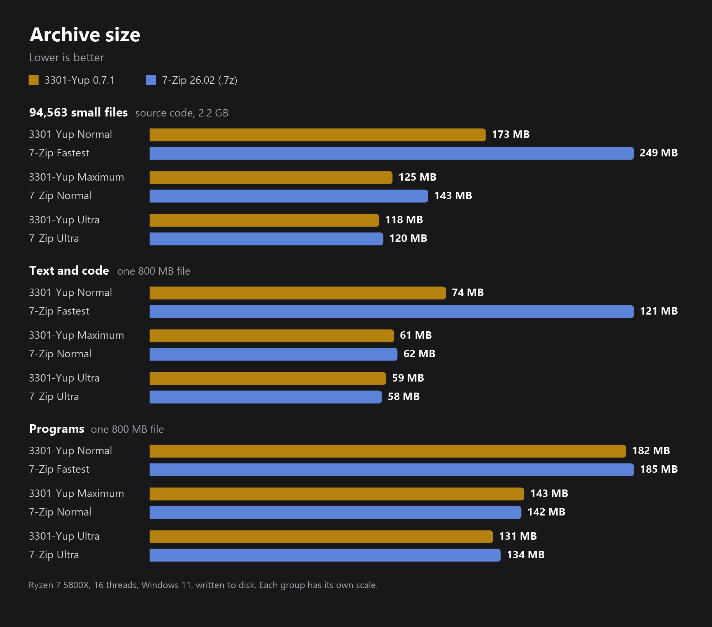

  

  
  
  
  

<h3 align="center">
  🗜️ The archiver that uses <i>all</i> of your PC, not just one core. 
  <a href="https://github.com/aywalh/3301-yup/releases/latest/download/3301-yup-win64.exe">⬇️ Download 3301-yup-win64.exe</a>  ·  <a href="https://3301-yup.vercel.app">🌐 Website</a>
</h3>

---

## ⚡ Why 3301-Yup?

**The default level beats 7-Zip's fastest level on speed and on size.** 3301-Yup Normal packs **1.5 to 2.3× faster** than 7-Zip Fastest, and its archives are up to **39 % smaller**. 3301-Yup packs on every core at once, and it doesn't waste time re-squeezing photos and videos that can't get any smaller.

### Unpacking

| Test set | 3301-Yup | 7-Zip |
|---|---|---|
| 94,563 small files | 80 to 86 s | 94 to 95 s |
| Text and code | 0.7 to 1.0 s | 0.7 to 1.1 s |
| Programs | 1.1 to 1.2 s | 0.7 to 2.4 s |

Ranges run from the fastest to the strongest level. With many small files, most of that time is Windows creating the files.

### Where 7-Zip still wins

- **Ultra on many small files:** 7-Zip packs 94,563 files in 79 s, 3301-Yup takes 95 s. The archive is 2 MB smaller with 3301-Yup (118 MB against 120 MB).
- **Ultra on text and code:** 7-Zip's archive is 1 MB smaller (58 MB against 59 MB), but it takes 61 s against 38 s.
- **CPU work at Ultra:** 7-Zip uses 15 to 25 % less CPU time in total. 3301-Yup finishes sooner on big files because it uses more cores at once, and it needs far less RAM: 3 GB against 22 GB on the small files.
- **Unpacking single big files:** 7-Zip's fastest level is a bit quicker.
- **Maximum against 7-Zip Normal** is faster on all three sets, but a tie on size for text and code, and 1 MB behind for programs.

Photos and videos barely shrink in any program. Your files will give different numbers.

How this was measured

One PC: Ryzen 7 5800X, 16 threads, Windows 11, nothing else running. 3301-Yup 0.7.1 against 7-Zip 26.02 as `.7z` at Fastest (mx1), Normal (mx5, its default) and Ultra (mx9). Real writes to disk, and each 3301-Yup archive was unpacked and compared byte for byte.

- **94,563 small files:** the source code of Rust crates, 2.2 GB
- **Text and code:** the same kind of files plus documentation joined into one 800 MB file
- **Programs:** Rust toolchain files joined into one 800 MB file

## 🖥️ Looks like this

Open any archive and walk through it like a folder in Explorer: sortable columns, real icons, double-click to open a file. Then click **Extract here** or **Extract to…**. Drop files in, pick a level, and click **Create .yup**. That's the whole app.

## 📊 Live progress

You see the time left, the speed, the files, the sizes and the ratio in real time. **Pause** it, **Cancel** it, or send it to the **Background** so your PC stays snappy while it works.

## 🎚️ You choose: speed or size

**Normal** is the sweet spot and the default. Need it tiny? **Ultra** squeezes out every byte, it just takes its time. The right-click menu uses your choice too.

## 🔁 No more "this file already exists" chaos

You see both files with their real icons, sizes and dates, then pick **Yes**, **No**, **Auto Rename** or **… to All**.

## 🧰 Everything it does

| | |
|---|---|
| 📦 **Packs** | into `.yup`: zstd on every CPU core, small files packed together for smaller archives, media stored as-is |
| 📂 **Opens** | `.yup` `.zip` `.7z` `.rar` `.tar` `.tar.gz` `.tgz` `.gz`, password zip/7z included |
| 🖱️ **Right-click menu** | Extract here · Extract to folder · Add to *name*.yup |
| 💣 **Zip bomb shield** | refuses archives that would blow up to over 1000× their size, and checks free disk space first |
| 🛡️ **Safe paths** | no archive can write outside the folder you picked |
| 🗂️ **Real icons** | `.yup` files get the zipped-folder icon in Explorer |
| 🔄 **Self-updating** | a new release shows an **Update** button, and one click installs it |
| 🪶 **One file** | a single ~9 MB exe: no installer, no runtime, no bloat |

## 🚀 Install in 10 seconds

1. **[Download 3301-yup-win64.exe](https://github.com/aywalh/3301-yup/releases/latest/download/3301-yup-win64.exe)**
2. Open it. That's it, it's the whole app.
3. Optional: click **Add to right-click menu**. Windows asks for admin once.

> **Windows says "unknown publisher"?** 3301-Yup isn't code-signed (yet). Click **More info → Run anyway**.

**Updating:** click **⬆ Update** in the app, or just open a newer `3301-yup-win64.exe`. It replaces the old one, right-click menu included.

## 🔒 Privacy

3301-Yup runs **100 % offline**. The only network request it ever makes is the update check: *"GitHub, what's the newest release?"*

There are no accounts, no telemetry and no tracking, and nothing about your files ever leaves your PC.

## ⚖️ License

Free to use, forever. **Not open source**, all rights reserved. Please don't redistribute modified copies.

made with too much ☕ · <a href="https://3301-yup.vercel.app">3301-yup.vercel.app</a>

